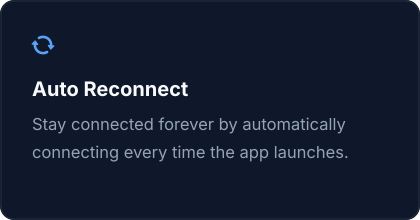
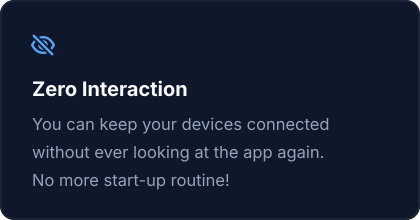

# AudioRelay Auto-Connect

<p align="center">
  
  
</p>

**Make the [AudioRelay](https://audiorelay.net) desktop Player connect to your server automatically, on Windows, macOS and Linux.**

AudioRelay is great, but every time the Player computer starts you have to open the window, go to the
Player tab, wait for the server to show up (or type the address you already saved) and click **Connect**.
If the server computer reboots or sleeps, you do it again. This small add-on does that click for you:

- **At launch**, the Player connects to the address you choose. If the server isn't up yet, it keeps trying.
- **If the connection drops** (server rebooted, slept, network blip), it reconnects once the server is back,
  to whichever server you were last connected to.
- **If you click Disconnect yourself**, it respects that and stays disconnected until you connect again.
- **If the server ends the session on purpose** (its user disconnects you, or a premium limit such as
  multi-device or session length), it also stays disconnected. It never works around AudioRelay's
  free-tier limits. If you find AudioRelay useful, consider buying premium.

> Unofficial. Not affiliated with or endorsed by AudioRelay or its developer. Contains no AudioRelay code.

> [!WARNING]
> **This software was written and tested with the help of AI, and it runs inside another program on your computer.**
> Please read [Before you install: a word of caution](#before-you-install-a-word-of-caution) first.

## Contents

- [Why this project exists](#why-this-project-exists)
  - [How small the official change would be](#how-small-the-official-change-would-be)
- [Before you install: a word of caution](#before-you-install-a-word-of-caution)
- [Install](#install): [Windows](#windows) · [macOS](#macos) · [Linux](#linux) · [After AudioRelay updates](#after-audiorelay-updates)
- [Options](#options)
  - [Manual setup (any platform)](#manual-setup-any-platform)
- [Compatibility](#compatibility)
- [Security & transparency](#security--transparency)
- [How it works](#how-it-works)
- [Troubleshooting](#troubleshooting)
- [Building](#building)
- [Legal](#legal)
- [Credits](#credits)

---

## Why this project exists

Auto-connect is one of the longest-standing requests from AudioRelay users. The
["Auto reconnect" feature request](https://community.audiorelay.net/t/auto-reconnect/152) was opened in
**December 2020** and has collected request after request since, from people using AudioRelay for
multi-room audio, always-on TV boxes, home-theater PCs, and two-PC setups. Without it, a "set and forget"
setup means remoting into a computer just to click one button.

As of the current stable release (**0.27.5**), the feature still isn't there. The developer has acknowledged
the request, and AudioRelay is a one-person project with plenty on its plate, so this isn't a complaint. It's
a bridge until an official version ships, built by someone who uses AudioRelay every day.

### How small the official change would be

While building this, it became clear that **AudioRelay already contains every piece of this feature**. It just
never gets triggered automatically:

| Already in AudioRelay 0.27.5 | What it means |
|---|---|
| The address you type in *Connect by address* is saved (`prefs_custom_connections`) and pre-filled next time | The app already remembers which server you want |
| Clicking **Connect** posts one `Connection(address)` event on an app-wide event bus; a service that starts with the app listens for it | Connecting is a single, UI-independent call |
| The Player has a full state machine: `Connecting → Running → RetryConnecting → Stopping`, with a built-in 5-minute reconnect | Retrying is already implemented, just time-limited |
| Stop reasons distinguish `user_requested` from errors | The app can already tell a manual Disconnect apart from a dropped connection |
| Windows already has a *Startup* settings section (*Launch on startup*, *Start minimized*) | There's an obvious place for one more toggle |

So the official feature is roughly: **one settings toggle, plus "on startup, if enabled and an address is
saved, post the same `Connection(address)` event the Connect button posts"**, and optionally "if the
built-in reconnect gives up and the user didn't press Disconnect, try again later." In app code that's
tens of lines. This add-on does exactly that from the outside. Its connect/retry logic is about 100 lines,
and most of the rest of the code exists only because it has to *find* those pieces inside an obfuscated app.

If you're the AudioRelay developer: please feel free to make this project obsolete. 🙂

---

## Before you install: a word of caution

Be careful with any code you find on the internet, including this project. It's worth saying plainly what this
project is and isn't:

- **It's random code from the internet.** It comes from an individual, not a company, and there's no support
  contract or guarantee behind it. Installing it means trusting whoever wrote it, and whoever can change it later.
- **It was largely written by AI.** The reverse-engineering, the code, the installers and this README were produced
  together with an AI (Anthropic's Claude). AI can write code that looks right and still has subtle bugs or security
  problems, and it can state things with more confidence than they deserve.
- **It was largely tested by AI, and only partly on real machines.** The tests were designed and run by AI, and an
  independent AI review was done before release. That catches a lot, but it isn't the same as review by experienced
  humans or long use by many people. See [Compatibility](#compatibility) for exactly what has been tried on real
  hardware. Some setups haven't been.
- **It runs inside AudioRelay**, with the same access to your computer that AudioRelay has, and it changes how
  AudioRelay behaves. Code in that position deserves more scrutiny, not less.

**If you're at all wary, don't just trust this repository. Instead:**

1. **Read the source yourself.** It's small: the agent is two files in [`src/arautoconnect`](src/arautoconnect),
   and each installer is one short script in [`installers/`](installers). Check that it does what this README says
   and nothing else.
2. **Build your own copy** from the source you reviewed (`./package.sh`, needs JDK 17+) instead of using the
   release downloads.
3. **Or have your own favorite AI write your own personal version.** Point it at this README (especially
   [How it works](#how-it-works) and [How small the official change would be](#how-small-the-official-change-would-be)).
   The idea is simple enough that you can get something you understand and control, without running anyone else's code.

This project is offered in good faith, with everything public so it can be checked. But "you can check it" only
helps if someone actually does. If you review it and find a problem, please [open an issue](../../issues).

---

## Install

Download the zip for your OS from the [**Releases**](../../releases) page and extract it.
Do this on the computer that **receives** audio (the one using the Player tab). You'll need the IP address
of the computer running the AudioRelay **server**. Giving that computer a fixed/reserved IP in your router helps.

### Windows

**One step (downloads AudioRelay and the mod):** [`Install-AudioRelay-AutoConnect.ps1`](scripts/Install-AudioRelay-AutoConnect.ps1)
installs AudioRelay 0.27.5 from audiorelay.net, then the latest release of this mod, in one go. It's handy for a new
PC or for going back from the 1.0 alpha.

1. Download the script: open [this link](https://raw.githubusercontent.com/non-entity-gh/audiorelay-autoconnect/main/scripts/Install-AudioRelay-AutoConnect.ps1),
   press <kbd>Ctrl</kbd>+<kbd>S</kbd>, and save it to your Downloads folder.
2. Open PowerShell in Downloads and run it with your server's IP:
   ```powershell
   powershell -ExecutionPolicy Bypass -File .\Install-AudioRelay-AutoConnect.ps1 -Server 192.168.1.50
   ```
   - It asks before closing a running AudioRelay, and you'll get an admin prompt for each installer.
   - The mod zip is checked against the release's `SHA256SUMS.txt` before anything runs. The AudioRelay
     installer's digital signature is shown, and you're asked before it runs if it isn't validly signed.
   - Add `-SkipAudioRelay` to only install or update the mod (e.g. after an AudioRelay update).

Like any script that downloads and installs software, read it before running it. It's short.

**Or install just the mod from the zip:**
1. Extract `audiorelay-autoconnect-windows.zip` (right-click > *Extract All*). Don't run it from inside the zip.
2. Double-click **`Install.bat`**, approve the admin prompt (AudioRelay lives in Program Files), and enter the server's IP.
3. If AudioRelay isn't already set to launch when Windows starts, the installer offers to turn on AudioRelay's own
   *Launch on startup* setting for you (optionally minimized to the tray). It writes the same Windows startup entry that
   AudioRelay's *Settings > Startup* switch does, so you can change it there any time.
4. Start AudioRelay (or reboot). Done.

Uninstall: double-click `Uninstall.bat`.

### macOS
```bash
cd ~/Downloads/audiorelay-autoconnect-macos
bash install.sh 192.168.1.50        # your server's IP
```
macOS AudioRelay is code-signed, so this **does not modify AudioRelay.app** (that would break its signature).
Instead it installs a per-user login item that starts AudioRelay with auto-connect, plus an
**"AudioRelay Auto-Connect"** launcher in `~/Applications` for starting it by hand. AudioRelay opened the normal
way still works, just without auto-connect. AudioRelay only allows one running copy, so if you had added
AudioRelay to *Login Items* yourself, remove it there; otherwise whichever copy starts first wins.
No `sudo` needed. Uninstall: `bash uninstall.sh`.

### Linux
```bash
cd ~/Downloads/audiorelay-autoconnect-linux
bash install.sh 192.168.1.50                             # .deb install (/opt/audiorelay) or Flatpak
bash install.sh 192.168.1.50 --app-dir ~/apps/audiorelay # .tar.gz extracted somewhere
```
- **.deb / .tar.gz:** copies the add-on next to `audiorelay.jar` and adds one line to `lib/app/AudioRelay.cfg` (backup saved). Uses `sudo` only if that folder isn't writable by you.
- **Flatpak:** adds a per-user `flatpak override` (one environment variable + read-only access to the add-on's folder). The Flatpak itself is untouched.
- **Start at login:** AudioRelay has no startup setting on Linux, so the installer offers to add a standard
  `~/.config/autostart` entry for it (skipped if you already have one). The uninstaller removes it only if the add-on created it.
- **AUR package:** not supported automatically yet (it uses its own launcher). See *Manual setup* below.

Uninstall: `bash uninstall.sh` (add `--app-dir ...` if you used it). Add `--skip-startup` to the install command to skip the login question.

### After AudioRelay updates
An AudioRelay update replaces its config, so auto-connect switches off. Run the installer again. If an update also
changes AudioRelay's internals too much, the add-on logs it and does nothing, and AudioRelay runs normally.

---

## Options

The installer sets `host=`. You can edit the option string (in `AudioRelay.cfg` on Windows/Linux, in
`~/Library/LaunchAgents/io.github.audiorelay-autoconnect.plist` on macOS, or by re-running the installer):

| Option | Default | Meaning |
|---|---|---|
| `host=ADDRESS` | (required) | IPv4/IPv6 address or hostname of the AudioRelay server |
| `persistent=false` | `true` | Connect at launch (retrying until the server is reachable), but don't reconnect after a later drop |
| `interval=SECONDS` | `10` | First retry delay; doubles after each failed attempt, up to 60 s |
| `delay=SECONDS` | `3` | Wait after launch before the first attempt |

Example: `-javaagent:$APPDIR/audiorelay-autoconnect.jar=host=192.168.1.50,persistent=false`

### Manual setup (any platform)
The add-on is a standard Java agent. Start AudioRelay's JVM with
`-javaagent:/path/to/audiorelay-autoconnect.jar=host=YOUR_SERVER_IP`, either as a `java-options=` line in
AudioRelay's `AudioRelay.cfg`, or through the `JAVA_TOOL_OPTIONS` environment variable for AudioRelay only.

---

## Compatibility

| Platform | AudioRelay | Status |
|---|---|---|
| Windows 10/11 | 0.27.5 | ✅ Confirmed working on a real two-PC setup |
| Linux (.tar.gz / .deb) | 0.27.5 | ✅ Tested by launching the real app with the add-on: it connected to a server |
| macOS (Apple Silicon & Intel) | 0.27.5 | 🟡 Logic tested against the real macOS build; the login-item launch path hasn't been confirmed on a physical Mac yet. Reports welcome! |
| Linux Flatpak | 0.27.5 | 🟡 Should work (same mechanism as macOS); not yet confirmed |
| Linux AUR package | – | ⚪ Manual setup only |
| 1.0.0 alpha / early-access builds | – | ⚪ Untested. The add-on finds what it needs by content, not by name, so it *may* work; if not, it does nothing |
| Android / iOS apps | – | ❌ Different app; not covered |

Each AudioRelay build (and each OS) scrambles its internal names differently, so the add-on never relies on
names. It locates the pieces by text the app contains (e.g. `Connection(address=`, `Running(endpoint=`).
That's why one jar works on all three platforms.

---

## Security & transparency

This runs inside AudioRelay, so you should know exactly what it does:

- **What it changes.** Windows/Linux: copies one `.jar` next to AudioRelay's own and adds one line to `AudioRelay.cfg` (backup saved as `AudioRelay.cfg.bak-autoconnect`). Only if you say yes: on Windows it turns on AudioRelay's own *Launch on startup* setting (the `AudioRelay` value under `HKCU\Software\Microsoft\Windows\CurrentVersion\Run`, which AudioRelay's settings control and which uninstalling leaves alone); on Linux it adds a login autostart entry. macOS: a LaunchAgent plist, a launcher app in `~/Applications`, and the jar in `~/.audiorelay-autoconnect/`. Flatpak: a per-user override. The uninstallers remove what the installers added (on Windows the small logs in `%TEMP%` stay; Flatpak keeps a harmless "no access" entry for the deleted folder in its override file).
- **No network access of its own.** It never opens a connection. It only asks AudioRelay to connect to the one address you configured, exactly like clicking Connect. No telemetry, no update checks.
- **Installers download nothing** and run nothing from the internet. They only copy files from the zip.
- **Inert everywhere else.** The agent does nothing unless it's running inside AudioRelay (it checks for `audiorelay.jar` on the class path), so it can't affect other Java programs.
- **Fails safe at runtime.** Every step inside AudioRelay is wrapped. If AudioRelay changes internally or anything unexpected happens, the add-on logs the reason and AudioRelay runs normally without auto-connect. One exception is outside its control: if the add-on's `.jar` file itself is **deleted or quarantined** (e.g. by antivirus) while still configured, Java refuses to start AudioRelay. Run the uninstaller (or reinstall) to fix that; see Troubleshooting.
- **Input is validated.** The server address must look like an IP/hostname (`A–Z a–z 0–9 . - : % [ ]`, not starting with `-`), so it can't inject extra JVM options or shell commands. The installers reject unknown options.
- **Where the jar lives.** Next to AudioRelay's own files. For the default Windows install and the `.deb` that's an admin/root-owned folder, so unprivileged programs can't swap it. For a `.tar.gz` in your home folder, macOS and Flatpak, it's in a folder you own, the same as AudioRelay itself or any per-user add-on.
- **Verifiable builds.** Releases are built by GitHub Actions from this source ([workflow](.github/workflows/release.yml); actions pinned by commit, read-only build job, a separate tag-only release job), with SHA-256 checksums and a [build provenance attestation](https://docs.github.com/actions/security-for-github-actions/using-artifact-attestations). Verify a download with:
  ```bash
  gh attestation verify audiorelay-autoconnect-windows.zip --repo non-entity-gh/audiorelay-autoconnect
  ```
  Or build it yourself with `./package.sh`. With JDK 17 (what CI uses) the jar and zips are byte-for-byte reproducible.
- **Windows notes.** `Install.bat` runs PowerShell with `-ExecutionPolicy Bypass` for that one script only; it doesn't change your system policy. Some antivirus tools are wary of scripts that elevate themselves and of Java agents in general. If yours flags it, the source is about 700 lines in [`src/`](src/arautoconnect) and you can build it yourself.

**Logs** (overwritten each launch; contains only the server address and state changes):
Windows `%TEMP%\audiorelay-autoconnect.log`, macOS `~/Library/Logs/audiorelay-autoconnect.log`,
Linux `~/.local/state/audiorelay-autoconnect.log` (Flatpak: `~/.var/app/net.audiorelay.AudioRelay/.local/state/`).

---

## How it works

1. AudioRelay is launched with `-javaagent:audiorelay-autoconnect.jar=host=…`.
2. Before the app starts, the agent scans `audiorelay.jar` (≈0.3 s) for three things: the `Connection(address)`
   event class, the startup service that listens for it, and the Player's state type.
3. It adds one call to that service's constructor (using the bytecode library built into the JDK, so no third-party code)
   to get a reference to the app's event bus and Player.
4. It also adds one call wherever the Player's state machine changes state, so it sees every transition,
   including a Disconnect that completes in a few milliseconds, along with its reason (`user_requested`, `error`, …).
5. A background thread posts the same `Connection(address)` event the Connect button posts when the Player is idle
   and should be connected. Retries back off from 10 s to 60 s.

It uses the bytecode library inside AudioRelay's bundled Java 17 runtime. If a future AudioRelay ships a much newer
Java where that's unavailable, the add-on just switches itself off (and logs why) until it's updated.

Code: [`Agent.java`](src/arautoconnect/Agent.java) (behavior) and [`Scanner.java`](src/arautoconnect/Scanner.java) (finding things in the obfuscated app).

## Troubleshooting

- **Nothing happens:** check the log (above). The first lines say whether it found AudioRelay's internals.
- **"You disconnected… paused" / "The server ended the session… paused":** expected. Connect once manually (or restart AudioRelay) to re-arm it.
- **AudioRelay won't start at all** after an antivirus scan or after deleting files: Java can't find the add-on's `.jar`. Run the uninstaller (or the installer again) to fix it.
- **Windows: the script closes or is blocked:** make sure you extracted the zip. If your PC enforces signed scripts (Group Policy *AllSigned*), the installer can't run. Use the manual setup instead. Running it from a mapped network drive can fail after the admin prompt; copy the folder to your PC first.
- **Stopped working after an AudioRelay update:** re-run the installer. If the log says it couldn't locate the internals, [open an issue](../../issues) with the log.
- **macOS: auto-connect works only sometimes after login:** AudioRelay is probably also in *System Settings > General > Login Items*. Only one copy can run, so remove it there. The add-on's login item already starts it.
- **macOS: "Picked up JAVA_TOOL_OPTIONS" in Console:** normal. That's the JVM announcing the add-on.

## Building
```bash
./package.sh   # JDK 17+; outputs dist/audiorelay-autoconnect.jar, per-OS zips and SHA256SUMS.txt
```

## Legal
MIT licensed. This project contains no AudioRelay code and isn't affiliated with AudioRelay. "AudioRelay" is
used only to say what this works with. AudioRelay's terms may not permit modifying the app; you are responsible
for how you use this. Provided as-is, without warranty.

## Credits
Created by [@non-entity-gh](https://github.com/non-entity-gh), an AudioRelay user who got tired of clicking Connect
every morning, with the reverse-engineering, code and testing done together with Anthropic's Claude (AI).
Everything is open for review. If you spot a problem, please open an issue.
